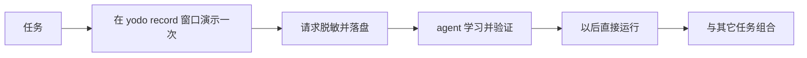

# yodo

> [!NOTE]
> **You only do once：只需要你演示一次。**

yodo 是帮你完成个人浏览器任务的 skill，与 `browser-use`、`agent-browser` 同类。

它使用你本机已登录的 Google Chrome，新任务只需演示一次，学会后直接运行脚本，**更快、token 更省**。

<a href="https://www.youtube.com/watch?v=KfW4o9qQoE0">
  
</a>

## 1. 性能

> [!NOTE]
> 本节数据在 **v1.2.0** 上测得。v2 的运行链路有变化，数据尚未重测，仅供参考。

### 1.1 对比结果（v1.2.0）

测试任务：读取 X Following 最近 3 条，生成中文摘要，再分别发布到知乎和即刻。

| 工具 | 成功 | 耗时 | 花费 |
|---|---:|---:|---:|
| **`yodo (run)`** | 是 | **56 秒** | **$0.24** |
| `agent-browser` | 是 | 6 分 25 秒 | $0.83 |
| `browser-use` | 是 | 9 分 45 秒 | $0.93 |
| `yodo (learn)` | 是 | 6 分 46 秒 | $0.83 |


- **`yodo (run)`**：运行已有脚本。
- **`yodo (learn)`**：用户演示后，学习并完成任务。

> [!NOTE]
> 清空上下文后，`agent-browser` 和 `browser-use` 执行速度基本不变；`yodo (run)` 可复用已有脚本，通常比首次学习更快。

每种方式只测试一次，结果不是多次平均。详细数据见 [Benchmark 说明](#6-benchmark-说明)。

### 1.2 性能分析

shell 次数表示 Claude Code 发起了多少次工具调用。思考时间是 trace 中所有 `Thought for ...` 的合计。

| 方式 | shell 次数 | trace 记录的思考时间 |
|---|---:|---:|
| **`yodo (run)`** | **3** | **20 秒** |
| `agent-browser` | 26 | 2 分 42 秒 |
| `browser-use` | 38 | 3 分 58 秒 |
| `yodo (learn)` | 22 | 2 分 19 秒 |

> [!NOTE]
> 思考时间不等于完整任务耗时。较少的 shell 次数和思考时间，表示复用已学会的接口比逐步操作页面更直接。

**`agent-browser`**

查看 X 并读取内容，再依次打开知乎和即刻，寻找入口、填写、发布并确认，共执行 **26 次 shell**。

**`yodo (run)`**

直接执行 3 个已有脚本，分别读取 X、发布知乎和发布即刻，共执行 **3 次 shell**。

> [!NOTE]
> `yodo (learn)` 只需执行一次。学会读取 X Following、发布知乎想法和发布即刻帖子后，`yodo (run)` 可在后续任务中直接复用。

## 2. 安装与更新

### 2.1 交给 agent 执行

把下面整段复制给你的 agent：

```text
请安装并更新 yodo。读取并严格执行这份说明：
https://github.com/yanggggjie/yodo/blob/main/skills/yodo/install.md
```

需要 Node ≥ 24 和 Google Chrome。首次安装要在 `chrome://extensions` 里加载一次 yodo 扩展，agent 会告诉你具体步骤；之后扩展有更新时，点一下刷新即可。

> [!IMPORTANT]
> - 新网站需先演示一次，yodo 不会自行探索。
> - 更适合普通网站；抖音、小红书等风控网站更多依赖页面操作，运行较慢。
> - 请勿批量使用，以免影响网站运行或账号安全。

### 2.2 遇到问题

> [!IMPORTANT]
> **yodo 完全以源码分发。** 全部源码和文档都在本机 `~/.yodo`。遇到任何问题，直接问你的 agent，它会读源码并帮你修复。

### 2.3 更新记录

#### v2.0.1

- 完全以源码分发，遇到问题可让 agent 读源码修复，见「2.2 遇到问题」。
- 从 v1 升级时给出完整的扩展加载步骤，并检查旧 task。
- 登录失效时提醒你重新登录。
- 运行时不再弹到前台：页面自己想打开的新窗口会被拦住。

#### v2.0.0

- 改用 Chrome 扩展连接，不再需要 remote debugging 和 Allow 弹窗；首次使用要加载一次扩展，点工具栏图标可立即重连。
- 录制更完整：点击、输入、勾选、滚动、页面跳转（含单页应用、新标签页、iframe），学习更准确；录制和运行窗口在后台打开。
- 命令统一为 `yodo`（`run`、`eval`、`record`、`daemon`、`doctor`），task 参数改为具名：`yodo run <task> --参数 值`。
- 运行更稳定：超时、并发等待、统一的失败信息与退出码，保存运行历史；`yodo eval` 可组合多个 task。
- 升级自动换新版本；任务或录制进行中时，结束后运行 `yodo daemon restart`。
- macOS 已验证，Windows、Linux 尚未充分测试。
- **不兼容**：v1 带参数的 task 需改成具名参数（`@param 名字`、`yodo.params.名字`）；`~/.yodo/temp` 和 `@executor` 取消。

#### v1.2.0

- 增加“我教你”教学入口。可以先开始演示，结束时再列出一个或多个要学习的操作。

#### v1.1.0

- 优化了 task 表示。已学会的网站操作运行更稳定，并能覆盖更多页面交互。
- 增加了 DOM 操作后读取 network response。查询结果和提交是否成功都更准确。

#### v1.0.0

- 支持通过一次用户演示学习需要登录态的网站操作，并在后续任务中复用。
- 支持组合运行多个已学会的网站操作。

## 3. 使用选项

### 3.1 直接布置任务

```text
yodo 帮我搜索一下知乎 agent，然后看看第三条帖子的内容是什么，再给第三条点赞
```

### 3.2 教 yodo 学会新操作

**a**.如果已知要教的具体操作，可以直接说：

```text
yodo 我教你查看我 X 关注用户的最新 10 条动态
```

**b**.也可以先开始演示，结束时再告诉 yodo 要学习什么：

```text
你：yodo 我教你用苹果官网

yodo：请切换到标题为 yodo record 的窗口（它在后台打开）完整演示，结束后回复“好了”，并告诉我要学习哪些操作。

你：好了，学习以下操作：

1. 查看 iPad 价格
2. 比较不同 iPad 型号
3. 查看指定型号的购买选项
```

yodo 先保存这次演示，再按你列出的操作逐个学习。只回复“好了”时，yodo 会先结束录制，再问你要学哪些。

### 3.3 查看 yodo 会什么

```text
yodo 你会什么？
```

### 3.4 组合复杂任务

可以在复杂任务的任意环节使用 yodo：

```text
TypeError: Cannot read properties of undefined (reading 'id')

先看一下上述报错信息，然后找到对应的代码，结合代码上下文看看有上报什么日志，
使用 yodo 来查日志，然后修复这个 bug
```

首次使用先按 agent 提示加载 yodo 扩展。

> [!IMPORTANT]
> 规则只有一条：输入中带上 `yodo` 这个触发词。

### 3.5 演示视频

<a href="https://www.youtube.com/watch?v=KfW4o9qQoE0">
  
</a>

## 4. 工作方式

### 4.1 第一次学习



1. 你在标题为 `yodo record` 的窗口中按清单演示。
2. yodo 录下请求和你的操作（点击、输入、滚动、跳转），并在落盘前处理敏感信息。
3. agent 根据演示材料学会任务。

### 4.2 后续运行

1. agent 找到匹配的 task。
2. yodo 使用 Chrome 中现有的登录态完成任务。

## 5. 票据及隐私

### 5.1 运行时

token 和 Cookie 保存在 Chrome 中。脚本在页面内使用当前登录态，agent 不读取原始凭据。

### 5.2 学习时

token、Cookie 和密码在交给 agent 前脱敏，录制的材料可在 `~/.yodo/record` 查看。同一原始值稳定替换为同一个 `secret_NNN`；Cookie 名称、token 类型和普通业务字段保留，原始值不可见。

**Cookie 示例**

```text
# 原始
Cookie: sid=s3cretValue; theme=dark

# agent 看到的
Cookie: sid=⟨secret_001:text⟩; theme=⟨secret_002:text⟩
```

**Token 示例**

```text
# 原始
Authorization: Bearer aaa.bbb.ccc
{ "token": "aaa.bbb.ccc", "itemId": "123456789" }

# agent 看到的
Authorization: Bearer ⟨secret_001:jwt⟩
{ "token": "⟨secret_001:jwt⟩", "itemId": "123456789" }
```

### 5.3 本机数据

源码、`task`、`record` 等所有数据都保存在本机，可随意查看：

```text
~/.yodo/
```

### 5.4 Chrome 扩展与权限

扩展只做一件事：把本机 yodo 进程的指令转给 Chrome。声明的权限：

| 权限 | 用途 |
|---|---|
| `debugger` | 对页面执行操作和读取页面事件（录制、运行都靠它） |
| `tabs` | 打开、关闭 yodo 自己的窗口和标签页 |
| `nativeMessaging` | 与本机的 yodo 进程通信，不经过网络 |
| `storage`、`alarms` | 记录 yodo 打开了哪些窗口；断线后自动重连 |

- 只操作 yodo 自己打开的窗口和标签页（含其中新开的标签页），其它一律拒绝。
- 没有网站（host）权限，也不对外联网（唯一的 `fetch` 读的是扩展自己的文件，用来计算版本）。
- `tabs` 权限技术上能看到所有标签页的地址和标题，所以边界写在代码里：扩展只有约 270 行，源码在 [`skills/yodo/src/chrome-extension/`](skills/yodo/src/chrome-extension/)，可直接查看。

## 6. Benchmark 说明

### 6.1 前置条件与任务

X、知乎、即刻都已在本机 Chrome 登录。

```text
使用 [yodo / browser-use / agent-browser]

1. 打开 X 我的 Following，取最近 3 条，总结成一段中文摘要，后缀带 from-[工具名]
2. 用这段摘要发一条知乎想法
3. 用这段摘要发一条即刻新动态
```

### 6.2 成功条件与测试设定

知乎和即刻两条内容均确认发布，且后缀正确。

| 项目 | 设定 |
|---|---|
| 环境 | Claude Code v2.1.251 |
| 模型 | `claude-sonnet-5`，偶发少量 haiku，具体见 `/cost` |
| 次数 | 每家、每阶段 1 次 |
| 计量 | 任务结束后在同一 session 中运行 `/cost` |

耗时取 `Total duration (wall)`，花费取 `Total cost`。测试不用 MCP，不用站点官方 API。每家从新 session 或 `/clear` 开始，只运行一件任务。

### 6.3 原始记录

| 工具 | 目录与文件 |
|---|---|
| `yodo (run)` | [`bench/results/yodo/run/`](bench/results/yodo/run/) · [`prompt`](bench/results/yodo/run/prompt.txt) · [`cost`](bench/results/yodo/run/useage.txt) · [`trace`](bench/results/yodo/run/trace-run.txt) |
| `agent-browser` | [`bench/results/agent-browser/`](bench/results/agent-browser/) · [`prompt`](bench/results/agent-browser/prompt.txt) · [`cost`](bench/results/agent-browser/useage.txt) · [`trace`](bench/results/agent-browser/trace.txt) |
| `browser-use` | [`bench/results/browser-use/`](bench/results/browser-use/) · [`prompt`](bench/results/browser-use/prompt.txt) · [`cost`](bench/results/browser-use/usage.txt) · [`trace`](bench/results/browser-use/trace.txt) |
| `yodo (learn)` | [`bench/results/yodo/learn/`](bench/results/yodo/learn/) · [`prompt`](bench/results/yodo/learn/prompt.txt) · [`cost`](bench/results/yodo/learn/useage.txt) · [`trace`](bench/results/yodo/learn/trace-learn.txt) |

`cost` 包含花费、耗时和模型用量；`trace` 包含思考时间、文件读取、shell 调用和最终结果。

### 6.4 运行备注

- **`yodo (run)`**：已经学会了这个任务，直接执行。
- **`agent-browser`**：使用独立 profile `~/temp-agent-browser-profile/` 的标准版 Chrome 和 CDP，否则无法登录 google 账号。
- **`browser-use`**：读取 X Following 时跳过一条广告推文；知乎和即刻均一次发布成功。
- **`yodo (learn)`**：用户先演示，agent 学会并验证后完成任务。
- 图由 [`bench/charts.py`](bench/charts.py) 生成。

## 7. License

### 7.1 适用范围

yodo 源码使用 [Apache License 2.0](LICENSE)。用户创建的 `task`、`record`、session 和其它运行数据均属用户。

**使用要求：yodo 仅用于完成个人浏览器任务，不得用于恶意抓取数据。**
