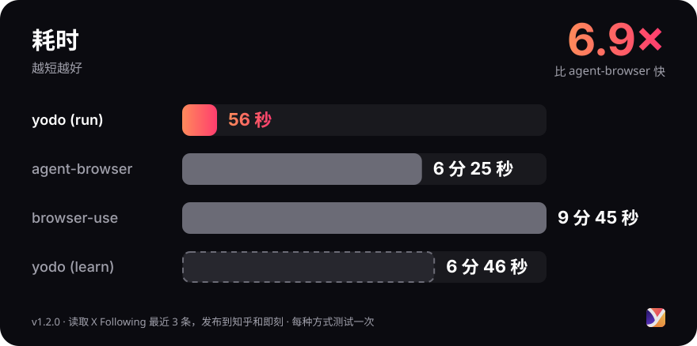
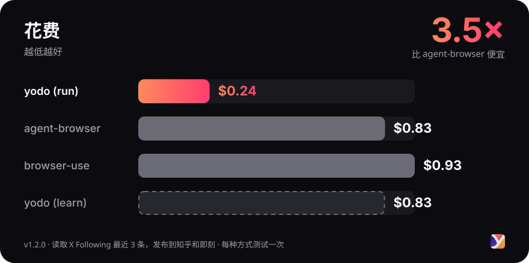
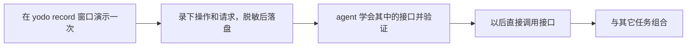

<h1>
  <picture>
    <source media="(prefers-color-scheme: dark)" srcset="brand/wordmark-dark.svg">
    
  </picture>
</h1>

> [!NOTE]
> **You only do once：你只演示一次。**

**录制你的操作，学会其中的接口，之后直接调用接口，快！**

yodo 是帮你完成个人浏览器任务的 skill，与 `browser-use`、`agent-browser` 同类。它使用你本机已登录的 Google Chrome：新任务只需演示一次，学会后直接运行脚本，**更快、token 更省**。

**请看视频⬇️**

https://github.com/user-attachments/assets/0f3b3dcd-3ee8-4030-97be-7cd4d6a04ddb

测试任务：读取 X Following 最近 3 条，生成中文摘要，再分别发布到知乎和即刻。

| 工具 | 成功 | 耗时 | 花费 |
|---|---:|---:|---:|
| **`yodo (run)`** | 是 | **56 秒** | **$0.24** |
| `agent-browser` | 是 | 6 分 25 秒 | $0.83 |
| `browser-use` | 是 | 9 分 45 秒 | $0.93 |
| `yodo (learn)` | 是 | 6 分 46 秒 | $0.83 |





`yodo (run)` 是运行已学会的脚本，`yodo (learn)` 是演示后学习并完成任务；学习只需一次。数据在 v1.2.0 上测得，v2 未重测，每种方式只测一次。分析与复现方法见 [bench/README.md](bench/README.md)。

## 安装

把下面整段复制给你的 agent：

```text
请安装并更新 yodo。读取并严格执行这份说明：
https://github.com/yanggggjie/yodo/blob/main/skills/yodo/install.md
```

需要 Node ≥ 24 和 Google Chrome。首次安装要在 `chrome://extensions` 里加载一次 yodo 扩展，agent 会告诉你具体步骤；之后扩展有更新时，点一下刷新即可。macOS 已验证，Windows、Linux 尚未充分测试。

> [!IMPORTANT]
> - 新网站你先做一遍，yodo 在旁边学，以后替你做。yodo 不会自己乱点，不会误操作你的账号。
> - 更适合普通网站；抖音、小红书等风控网站更多依赖页面操作，运行较慢。
> - 请勿批量使用，以免影响网站运行或账号安全。

**遇到问题**：yodo 完全以源码分发，全部源码和文档都在本机 `~/.yodo`。直接问你的 agent，它会读源码并帮你修复。

## 使用

输入中带上 `yodo` 这个触发词即可，可以用在复杂任务的任意环节。

**直接布置任务**

```text
yodo 帮我搜索一下知乎 agent，然后看看第三条帖子的内容是什么，再给第三条点赞
```

如果 yodo 还没学过这件事，它会请你做一遍，你照常做完就行：

```text
yodo：我还没学过这个。请你在「yodo record」窗口里做一遍，我来学，以后我来做。

1. 搜索「机械键盘」
2. 点开第一条

做完说「好了」。
```

**教 yodo 学会新操作**

已知要教的具体操作，可以直接说：

```text
yodo 我教你查看我 X 关注用户的最新 10 条动态
```

也可以先开始演示，结束时再告诉 yodo 要学习什么：

```text
你：yodo 我教你用苹果官网

yodo：请切换到标题为 yodo record 的窗口（它在后台打开）完整演示，结束后回复“好了”，并告诉我要学习哪些操作。

你：好了，学习以下操作：

1. 查看 iPad 价格
2. 比较不同 iPad 型号
3. 查看指定型号的购买选项
```

yodo 先保存这次演示，再按你列出的操作逐个学习。只回复“好了”时，yodo 会先结束录制，再问你要学哪些。

**查看 yodo 会什么**

```text
yodo 你会什么？
```

**组合到复杂任务里**

```text
TypeError: Cannot read properties of undefined (reading 'id')

先看一下上述报错信息，然后找到对应的代码，结合代码上下文看看有上报什么日志，
使用 yodo 来查日志，然后修复这个 bug
```

## 工作方式与隐私



- **运行时**：token 和 Cookie 保存在 Chrome 中。脚本在页面内使用当前登录态，agent 不读取原始凭据。
- **学习时**：token、Cookie 和密码在交给 agent 前脱敏，示例见 [PRIVACY.md](PRIVACY.md)；录制的材料可在 `~/.yodo/record` 查看。
- **本机数据**：源码、`task`、`record` 等所有数据都保存在本机 `~/.yodo/`，可随意查看。

**Chrome 扩展与权限**：扩展只做一件事，把本机 yodo 进程的指令转给 Chrome。

| 权限 | 用途 |
|---|---|
| `debugger` | 对页面执行操作和读取页面事件（录制、运行都靠它） |
| `tabs` | 打开、关闭 yodo 自己的窗口和标签页 |
| `nativeMessaging` | 与本机的 yodo 进程通信，不经过网络 |
| `storage`、`alarms` | 记录 yodo 打开了哪些窗口；断线后自动重连 |

- 只操作 yodo 自己打开的窗口和标签页（含其中新开的标签页），其它一律拒绝。
- 没有网站（host）权限，也不对外联网（唯一的 `fetch` 读的是扩展自己的文件，用来计算版本）。
- `tabs` 权限技术上能看到所有标签页的地址和标题，所以边界写在代码里：扩展只有约 270 行，源码在 [`skills/yodo/src/chrome-extension/`](skills/yodo/src/chrome-extension/)，可直接查看。

## 更多

- [更新记录](CHANGELOG.md)
- [性能分析与复现方法](bench/README.md)
- [品牌规范](brand/README.md)
- **License**：yodo 源码使用 [Apache License 2.0](LICENSE)。用户创建的 `task`、`record`、session 和其它运行数据均属用户。**使用要求：yodo 仅用于完成个人浏览器任务，不得用于恶意抓取数据。**
